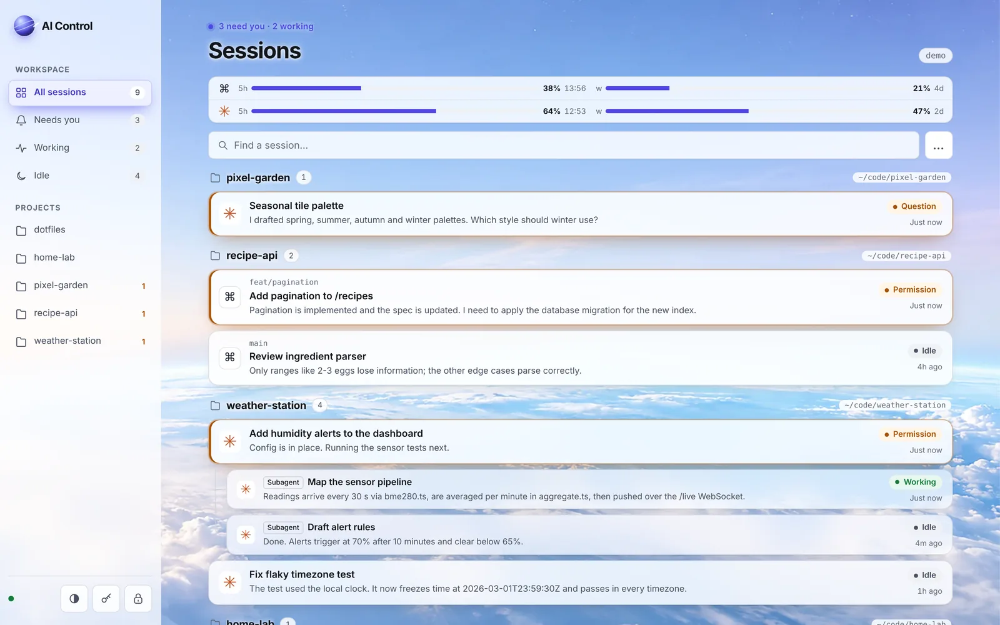
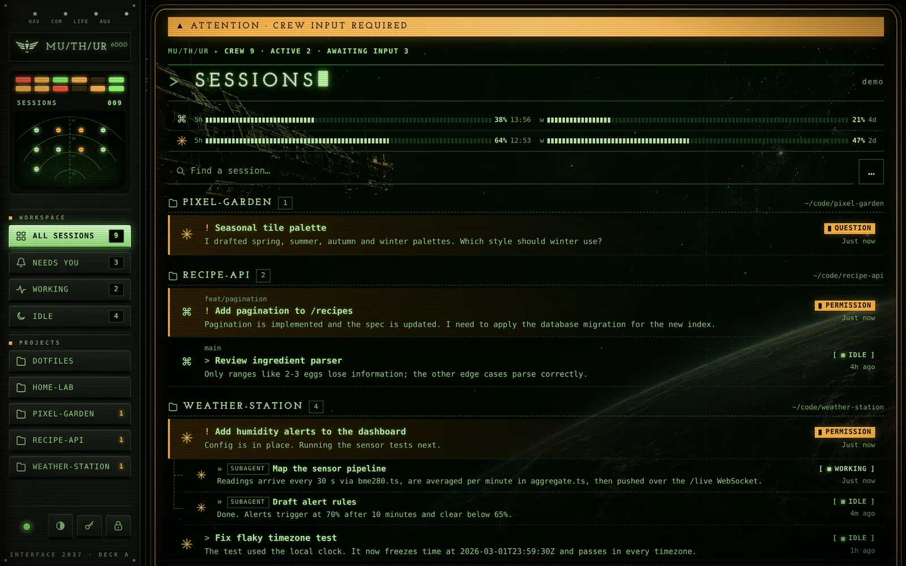
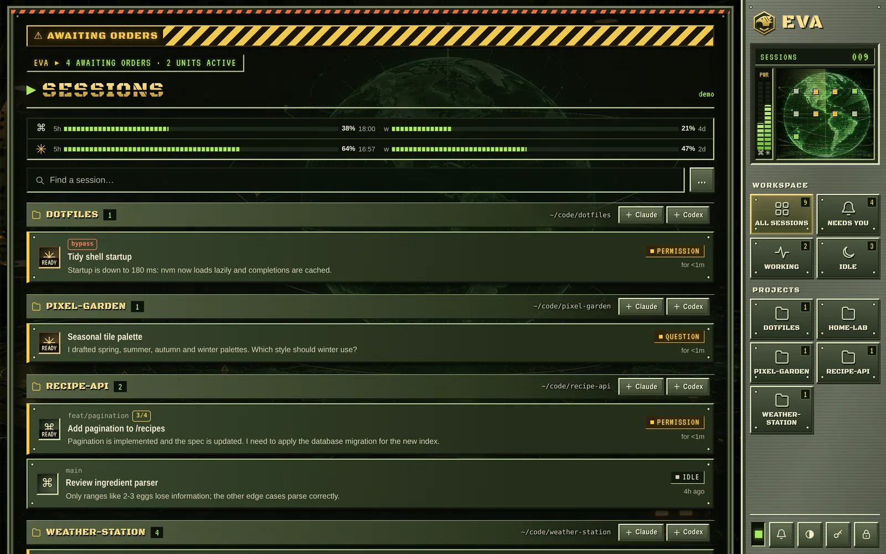
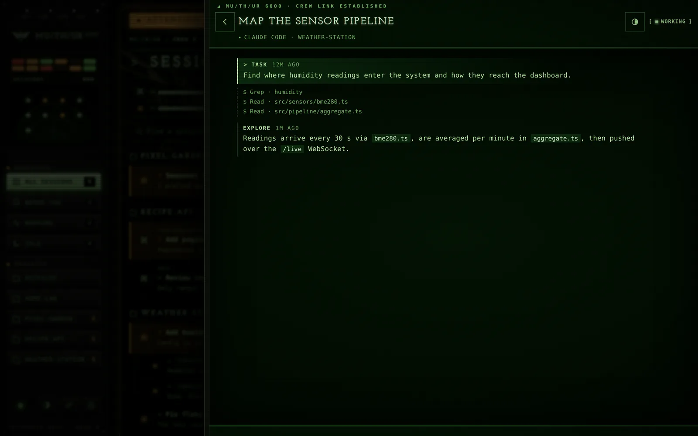
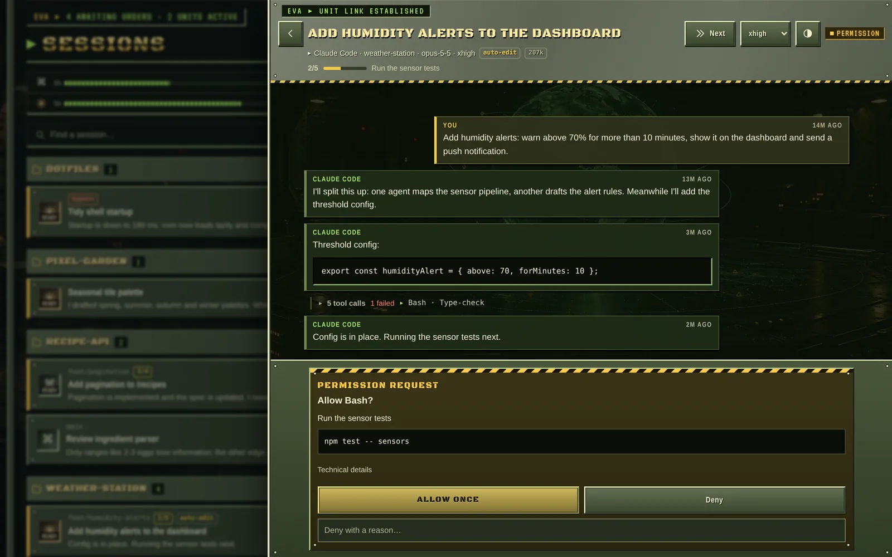
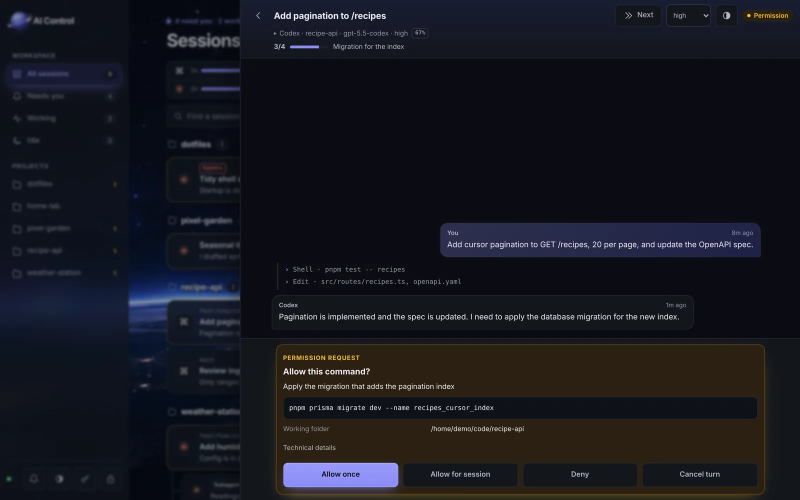
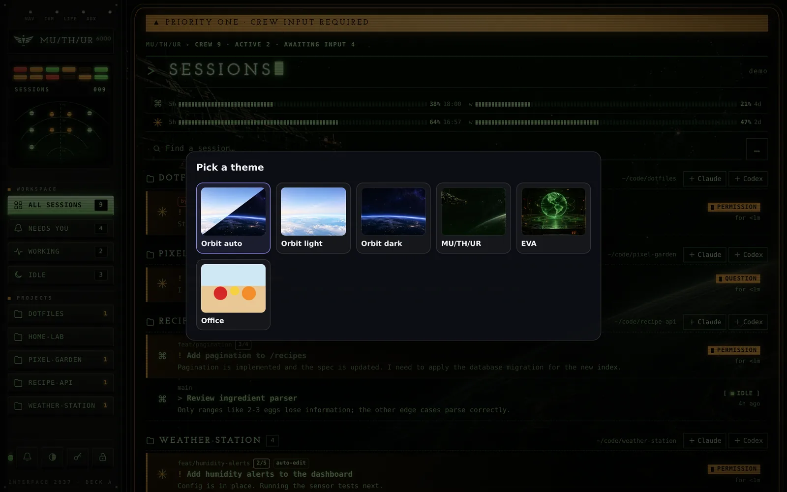
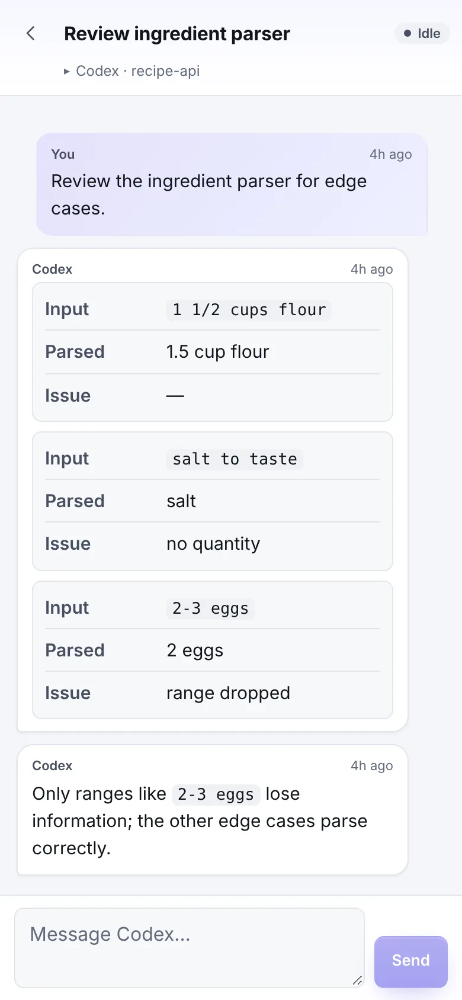
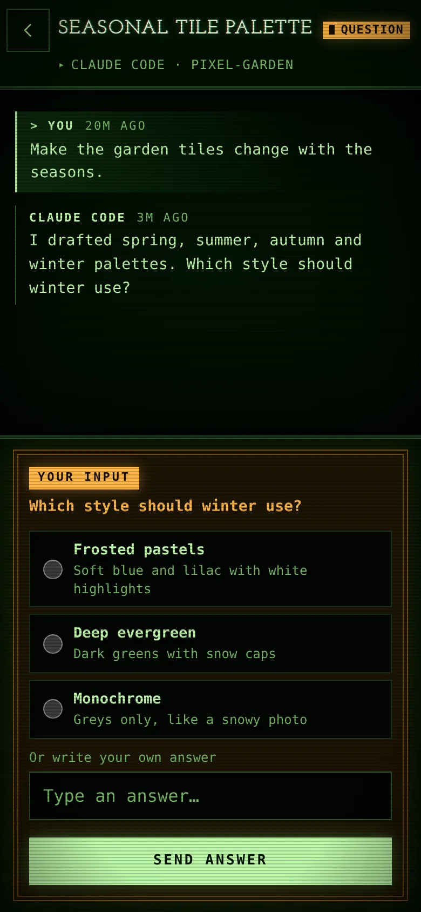
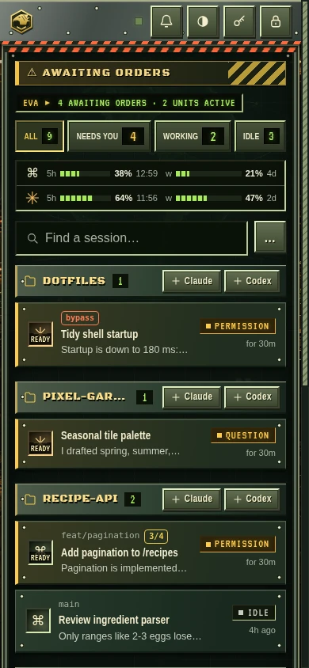

# AI Control

A self-hosted dashboard for keeping track of your local Codex and Claude Code sessions from a browser or phone.

> **Disclaimer:** a hobby project shared as is under the [MIT License](LICENSE). It is just a way to keep track of your agents; use it at your own risk. The authors take no responsibility for anything it does, including approvals and messages sent to your agents. Not affiliated with OpenAI, Anthropic, or the owners of *Alien* or *Command & Conquer*.



## Features

- Every running Codex and Claude Code session, by project or as a flat list, sorted needs input → working → idle.
- Answer Claude and Codex permission requests and questions: allow once, for the session or always, or deny with a reason. Edits show as diffs, plans as Markdown. The terminal stays usable; whichever answers first wins. Nothing is auto-approved.
- Send messages: start or steer Codex turns, type into Claude sessions running in tmux. Stop a turn, change effort, or start a new Claude or Codex in a project's tmux session.
- Recent history as safe Markdown, with folded tool calls, errors and older pages on demand. Claude subagents and workflow workers are nested under their session.
- Model, effort, permission mode, context, plan progress, goal and cost per session; unread dots for finished work.
- Notifications (HTTPS) and theme sounds when a session needs you, a favicon badge, and `/` `j` `k` `n` shortcuts.
- Five-hour and weekly usage limits for both accounts, with a warning when the current pace runs past the limit.
- This computer only, or your other devices over Tailscale. PIN or password, ten-minute idle lock.

## More is more

MU/TH/UR and EVA go all in: boot sequences, CRT scanlines, typed-out text, radar contacts that blip on status changes and close in the longer they wait, emergency lighting, hazard stripes, build bars fed by plan progress and a power bar fed by your usage limits that drops the radar to static when spent. Orbit is the calm option. Effects never block a control and switch off with reduced motion.

## Screenshots

| MU/TH/UR | EVA |
| --- | --- |
|  |  |
|  |  |

| Orbit dark | First visit |
| --- | --- |
|  |  |

| Phone: Orbit | Phone: MU/TH/UR | Phone: EVA |
| --- | --- | --- |
|  |  |  |

## Start

Requires Linux, Node 22.12+, `tmux` and `ss`. Tailscale is optional.

```sh
npm ci
npm start
```

The first run asks how to reach the dashboard (Tailscale or this computer only) and for a PIN or password. It then connects the Claude hooks in `~/.claude/settings.json` (backed up to `.local/`), starts the server in a tmux session named `aiControl` on port 47841, and prints the URL.

```sh
npm run attach             # Open the server's tmux session
npm stop                   # Stop the server
npm restart                # Restart it
npm run setup              # Change Tailscale/local mode and certificate
npm run password           # Change the PIN/password and sign out everywhere
npm run dev:local          # Run on 127.0.0.1 only
npm run demo               # Demo dashboard on port 47842, PIN 1234
npm run connect:claude     # Reinstall the Claude hooks
npm run disconnect:claude  # Remove them
npm test
```

## Network and security

- Listens only on the Tailscale IP or `127.0.0.1`, never the LAN.
- HTTPS needs a Tailscale certificate: enable HTTPS in the Tailscale admin console, then run `tailscale cert --cert-file .local/<host>.crt --key-file .local/<host>.key <host>`. Rerun it every 90 days. Without a certificate it uses HTTP; Tailscale still encrypts traffic between devices.
- Salted scrypt password hash, HttpOnly SameSite cookies, origin and CSRF checks; five failed logins block an address for 15 minutes.
- Settings, logins and logs stay in `.local/`. The browser loads no third-party scripts, fonts or services.

## How it works

- **Codex:** connects to the app-server control socket (`~/.codex/app-server-control/`, or `CODEX_HOME`) and rejoins loaded threads.
- **Claude Code:** reads running sessions from `~/.claude/sessions` and transcripts from `~/.claude/projects`. Hooks forward questions and permission requests over a local socket. Messages are pasted into the session's tmux pane, or sent to its inbox outside tmux.
- **Usage:** Codex's `account/rateLimits/read`, and the Claude CLI's internal OAuth usage endpoint with its existing login. Credentials never leave the backend.

## License

MIT. Bundles [Marked](client/vendor/marked/LICENSE.md) (MIT) and three Google Fonts under the [SIL Open Font License](client/public/fonts/OFL.txt).
